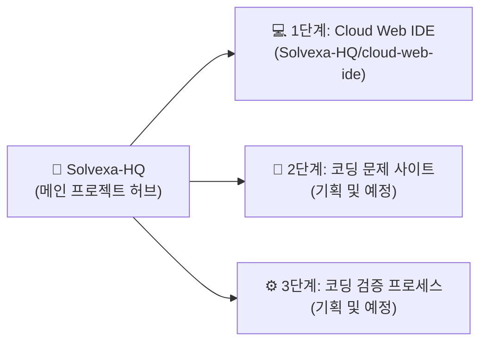

# 🚀 Solvexa-HQ | Cloud Coding Platform Project

> **언제 어디서나 코드를 작성하고, 문제를 풀고, 자동으로 검증받는 클라우드 기반 웹 코딩 플랫폼**  
> **Solvexa-HQ**는 프로젝트의 확장성과 모듈화를 위해 전체 플랫폼을 **3단계 레포지토리**로 분리하여 개발·운영합니다.

---

## 📌 전체 프로젝트 구조 (Repository Map)

각 단계별 레포지토리 링크를 클릭하면 해당 프로젝트의 소스 코드와 상세 기술 문서(`docs/`)를 확인하실 수 있습니다.

| 단계 | 프로젝트 구분 | 레포지토리 링크 | 핵심 요약 | 진행 상태 |
| :---: | :--- | :--- | :--- | :---: |
| **Phase 1** | **Web IDE 제작** | **[Solvexa-HQ/cloud-web-ide](https://github.com/Solvexa-HQ/cloud-web-ide)** | 모바일(폴더블)·태블릿·PC 대응 다중 언어 클라우드 웹 에디터, EC2 컨테이너 코드 실행 및 Supabase 클라우드 스니펫 저장소 | 🟢 **운영 및 고도화 중 (v1.4)** |
| **Phase 2** | **코딩 문제 사이트 제작** | *(레포지토리 생성 예정)* | 알고리즘/코딩 문제 조회, 난이도 분류, 문제 풀이 및 제출 웹 포털 (1단계 Web IDE 연동) | 🟡 **기획 단계 (틀 구성)** |
| **Phase 3** | **코딩 검증 프로세스 제작** | *(레포지토리 생성 예정)* | 제출된 코드에 대한 테스트케이스 자동 대조, 실행 시간/메모리 제한 측정 및 격리 채점 파이프라인 | 🟡 **기획 단계 (틀 구성)** |

---

## 💻 1단계: Cloud Web IDE (`Solvexa-HQ/cloud-web-ide`) — 현재 집중 개발 단계

1단계 프로젝트는 플랫폼의 핵심이 되는 **웹 기반 코드 에디터 및 원격 실행 환경**입니다.

- **레포지토리 바로가기**: **[https://github.com/Solvexa-HQ/cloud-web-ide](https://github.com/Solvexa-HQ/cloud-web-ide)**
- **핵심 구현 사항**:
  - **다중 언어 에디터**: CodeMirror 6 기반 Python 3.11, Node.js 20, C++ (GCC) 지원 및 모바일 빠른 특수기호 입력 바 제공
  - **인증 및 보안 제어**: Supabase GitHub OAuth 연동, 비로그인 사용자 코드 실행 차단 및 환경 변수/커밋 히스토리 보안 처리
  - **원격 실행 및 장애 대응**: AWS EC2 컨테이너 샌드박스 연동, 서버 OFF(절전) 시 7초 타임아웃(`AbortController`) 감지 및 DuckDNS 유동 IP 자동 갱신(`crontab`)
  - **CI/CD 자동 배포**: GitHub Actions를 통한 AWS S3 정적 호스팅 자동 빌드·동기화 및 CloudFront(HTTPS) 배포
- **상세 문서 바로가기 (`docs/`)**:
  - [1. 시스템 아키텍처 및 내부 동작 상세](https://github.com/Solvexa-HQ/cloud-web-ide/blob/main/docs/ARCHITECTURE.md)
  - [2. 인프라 운영 및 S3/CloudFront/EC2 배포 가이드](https://github.com/Solvexa-HQ/cloud-web-ide/blob/main/docs/INFRA_AND_DEPLOYMENT.md)
  - [3. 공동작업 및 로컬 개발 가이드](https://github.com/Solvexa-HQ/cloud-web-ide/blob/main/docs/COLLABORATION_GUIDE.md)
  - [4. 버전별 상세 변경 이력 (v1.0 ~ v1.4)](https://github.com/Solvexa-HQ/cloud-web-ide/blob/main/docs/CHANGELOG.md)

---

## 📝 2단계: 코딩 문제 사이트 제작 (Outline)

> *1단계 Web IDE 기능 완성 이후 본격 착수 예정인 단계입니다.*

- **목표**: 사용자가 문제를 읽고 1단계에서 구축한 Web IDE 환경에서 곧바로 코드를 작성·제출할 수 있는 문제 포털 구축
- **예정 범위**: 문제 목록/검색, 문제 상세 및 입출력 예제 화면, 사용자별 풀이 이력 관리

---

## ⚙️ 3단계: 코딩 검증 프로세스 제작 (Outline)

> *2단계 문제 사이트와 연동되어 제출 코드의 정오답을 판별하는 채점 백엔드 단계입니다.*

- **목표**: 안전한 격리 컨테이너 환경에서 다중 테스트케이스를 검증하는 자동 채점 프로세스 구축
- **예정 범위**: 테스트케이스 입력/출력 비교, 무한 루프 및 과도한 리소스 사용 방지를 위한 시간/메모리 제한 검증
